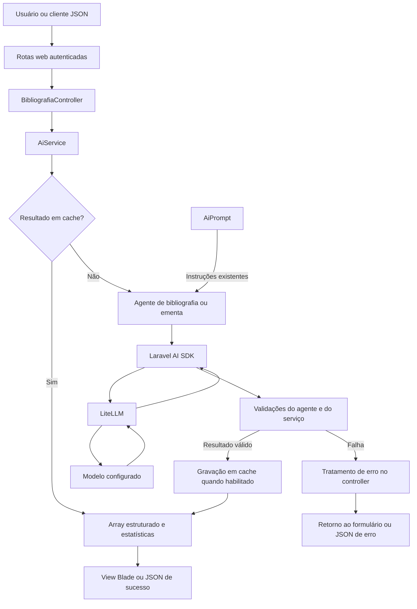
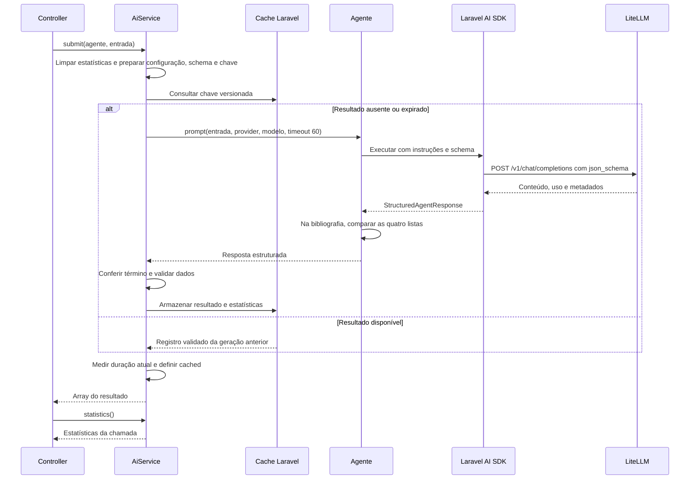

# Implementação do Laravel AI SDK no Laravel 13

Este documento explica a integração de bibliografia e revisão de ementas com o Laravel AI SDK na aplicação Laravel 13. Ele descreve as responsabilidades dos arquivos, os contratos de dados, a execução pelo LiteLLM, as validações, o cache, as estatísticas e a apresentação dos resultados.

Este guia serve como referência para entender e manter a implementação existente e os ajustes de compatibilidade do Laravel 13. O [guia do sistema de logs](sistema-de-logs.md) detalha os canais gerais e de IA, a configuração, o visualizador administrativo e a retenção dos arquivos.

## Índice

- [1. Visão geral e dependências](#1-visão-geral-e-dependências)
- [2. Organização do código](#2-organização-do-código)
- [3. Configuração do SDK e do LiteLLM](#3-configuração-do-sdk-e-do-litellm)
- [4. Prompts, instruções e entrada do usuário](#4-prompts-instruções-e-entrada-do-usuário)
- [5. Agente de bibliografia](#5-agente-de-bibliografia)
- [6. Agente de ementa](#6-agente-de-ementa)
- [7. Execução compartilhada no AiService](#7-execução-compartilhada-no-aiservice)


## 1. Visão geral e dependências

A integração usa `laravel/ai` com o requisito `^1.2@stable` em [composer.json](../composer.json). O projeto exige PHP `^8.3` e Laravel `^13.0`. As versões registradas em [composer.lock](../composer.lock) são:

| Dependência | Versão instalada |
| --- | --- |
| `laravel/framework` | 13.36.0 |
| `laravel/ai` | 1.2.0 |
| `laravel/tinker` | 3.0.2 |
| `phpunit/phpunit` | 12.5.39 |
| `rap2hpoutre/laravel-log-viewer` | 3.0.0 |
| `uspdev/laravel-tools` | 1.6.0 |

O upgrade preserva o SDK, os agentes, os prompts, a estrutura de inicialização existente e a configuração de sessão e cache. Em uma instalação existente, `composer install` aplica as versões do lockfile.

O `laravel-tools` 1.6.0 exige Log Viewer `^2.2`, mas essa série não aceita Laravel 13. O requisito `3.0.0 as 2.5.0` instala o Log Viewer 3.0.0 e satisfaz a restrição do pacote USP por meio de um alias do Composer. Essa versão mantém o contrato `Crypt::encrypt()`/`Crypt::decrypt()` dos links das views originais do pacote USP, usadas diretamente sem publicação ou sobrescrita na aplicação. A versão exata gera um aviso esperado em `composer validate`; o alias deve ser reavaliado quando o pacote USP aceitar Log Viewer 3 diretamente, verificando também a compatibilidade dos links.

Cada POST válido executa um fluxo síncrono: a aplicação aguarda o resultado ou uma falha para responder. Uma entrada já processada pode ser atendida pelo cache sem chamar o modelo novamente.



Os agentes utilizados pelos endpoints não implementam `Conversational` nem `HasTools`. O fluxo não mantém histórico de conversa e não utiliza streaming, filas, embeddings ou RAG. A migração não acrescentou tabelas de conversas nem uma estrutura de persistência de estatísticas.

## 2. Organização do código

| Arquivo | Responsabilidade na integração |
| --- | --- |
| [composer.json](../composer.json) e [composer.lock](../composer.lock) | Declarar a dependência do SDK e registrar as versões instaladas. |
| [config/ai.php](../config/ai.php) | Selecionar provider, driver, URL, chave e modelo de texto. |
| [config/aiService.php](../config/aiService.php) | Definir a retenção do cache de respostas. |
| [config/cache.php](../config/cache.php) | Escolher o armazenamento usado pela facade `Cache`. |
| [config/logging.php](../config/logging.php) | Configurar canais, níveis e habilitação da captura das chamadas de IA. |
| [app/Services/AiConversationLogger.php](../app/Services/AiConversationLogger.php) | Correlacionar entrada, tráfego HTTP, resultado e erros de cada execução de IA. |
| [app/Logging/AiConversationFormatter.php](../app/Logging/AiConversationFormatter.php) | Apresentar os eventos em blocos legíveis com cabeçalho compatível com o Log Viewer. |
| [app/Providers/AppServiceProvider.php](../app/Providers/AppServiceProvider.php) | Compartilhar o logger na requisição e registrar os listeners HTTP da captura. |
| [app/Models/AiPrompt.php](../app/Models/AiPrompt.php) | Manter as regras de conteúdo dos prompts e a lista de normas bibliográficas. |
| [app/Ai/Agents/BibliografiaAgent.php](../app/Ai/Agents/BibliografiaAgent.php) | Fornecer instruções, schema e verificação das quatro listas bibliográficas. |
| [app/Ai/Agents/EmentaAgent.php](../app/Ai/Agents/EmentaAgent.php) | Fornecer instruções e schema da revisão bilíngue. |
| [app/Services/AiService.php](../app/Services/AiService.php) | Executar agentes, validar resultados, administrar cache e normalizar estatísticas. |
| [app/Http/Controllers/BibliografiaController.php](../app/Http/Controllers/BibliografiaController.php) | Validar requisições, criar os agentes e apresentar sucesso ou falha nos dois serviços. |
| [routes/web.php](../routes/web.php) | Registrar os endpoints de bibliografia e ementa com autenticação. |
| [app/Http/Middleware/VerifyCsrfToken.php](../app/Http/Middleware/VerifyCsrfToken.php) e [config/sanctum.php](../config/sanctum.php) | Aplicar a proteção de origem e token do Laravel 13 por meio de `PreventRequestForgery`. |
| [resources/views/bibliografia/index.blade.php](../resources/views/bibliografia/index.blade.php) | Apresentar referências revisadas, explicações e confiança. |
| [resources/views/ementa/index.blade.php](../resources/views/ementa/index.blade.php) | Apresentar nota, análises e textos revisados em português e inglês. |
| [tests/Feature](../tests/Feature) | Verificar configuração, agentes, serviço e respostas HTTP. |

Apesar do nome, `BibliografiaController` contém tanto `bibliografia()` quanto `ementa()`. O Laravel resolve `AiService` pela injeção no construtor do controller. Não há binding específico desse serviço em `AppServiceProvider`.

## 3. Configuração do SDK e do LiteLLM

### 3.1 Variáveis de ambiente

As variáveis da integração estão exemplificadas em [.env.example](../.env.example):

```dotenv
AI_PROVIDER=litellm
LITELLM_URL=http://localhost:4000
LITELLM_API_KEY=
LITELLM_MODEL=gemini-flash
AI_CACHE_RETENTION=604800
```

`gemini-flash` é um exemplo de alias. O valor efetivo deve corresponder a um modelo exposto pelo gateway. O driver usa o protocolo compatível com OpenAI mesmo quando o LiteLLM encaminha a geração a outro fornecedor.

| Variável | Configuração consumida | Efeito |
| --- | --- | --- |
| `AI_PROVIDER` | `ai.default` | Seleciona a conexão de texto; o padrão é `litellm`. |
| `LITELLM_URL` | `ai.providers.litellm.url` | Define a base da API após normalização. |
| `LITELLM_API_KEY` | `ai.providers.litellm.key` | Autentica a chamada ao gateway. |
| `LITELLM_MODEL` | `ai.providers.litellm.models.text.default` | Define o alias enviado no campo `model`. |
| `AI_CACHE_RETENTION` | `aiService.cacheRetention` | Define, em segundos, a retenção dos resultados válidos. |
| `CACHE_DRIVER` | `cache.default` | Escolhe o armazenamento do cache de respostas deste projeto. |

As credenciais são lidas do ambiente pelo arquivo de configuração. O serviço consome `config()`, mantendo a integração compatível com o cache de configuração do Laravel.

### 3.2 Normalização da URL

`config/ai.php` remove barras finais de `LITELLM_URL` com `rtrim()`. Se a base já termina em `/v1`, ela é preservada; caso contrário, o arquivo acrescenta esse segmento. O gateway do SDK acrescenta `/chat/completions` ao executar o agente.

| Entrada em `LITELLM_URL` | Base em `config/ai.php` | Endpoint de geração |
| --- | --- | --- |
| `http://localhost:4000` | `http://localhost:4000/v1` | `http://localhost:4000/v1/chat/completions` |
| `http://localhost:4000/` | `http://localhost:4000/v1` | `http://localhost:4000/v1/chat/completions` |
| `http://localhost:4000/v1/` | `http://localhost:4000/v1` | `http://localhost:4000/v1/chat/completions` |
| `https://gateway.example.com/proxy` | `https://gateway.example.com/proxy/v1` | `https://gateway.example.com/proxy/v1/chat/completions` |

Uma URL vazia permanece `null`, permitindo que a configuração ausente seja detectada. O prefixo `/v1` preserva o endpoint usado pelo projeto antes da migração; ele é uma escolha desta configuração.

### 3.3 Seleção de provider e modelo

`AiService::submit()` obtém o nome da conexão com `Ai::getDefaultInstance()` e resolve seu modelo com `Ai::textProvider($provider)->defaultTextModel()`.

Por isso, o serviço respeita `AI_PROVIDER` e não fixa `litellm` no código de execução. Ao escolher outra conexão, suas credenciais e seu modelo padrão precisam estar configurados de acordo com o driver selecionado. O driver `openai-compatible` exige um modelo de texto padrão nessa utilização do serviço.

Os outros providers e as opções `default_for_*` de `config/ai.php` vieram da configuração publicada pelo SDK. Bibliografia e ementa utilizam apenas a operação de texto. O bloco `caching.embeddings` também pertence ao SDK e não controla o cache de respostas do `AiService`.

## 4. Prompts, instruções e entrada do usuário

`AiPrompt` permanece como fonte dos textos. Os agentes chamam:

```php
// Bibliografia: a norma altera somente a interpolação já existente no prompt.
AiPrompt::systemPrompt('bibliografia', ['standard' => $this->standard]);

// Ementa: utiliza o prompt existente sem parâmetros adicionais.
AiPrompt::systemPrompt('ementa');
```

`systemPrompt()` seleciona o conteúdo pelo identificador do serviço. Na bibliografia, a norma é interpolada nas regras de formatação e são mantidas as orientações de conteúdo, consulta ao Dedalus e confiança. Na ementa, são preservadas as instruções acadêmicas, a avaliação e a revisão bilíngue. Os blocos que exigiam JSON e repetiam sua estrutura foram retirados: os métodos `schema()` dos agentes definem o formato enviado pelo SDK.

O conteúdo do usuário é passado separadamente a `prompt($input, ...)`. No driver configurado, o SDK monta uma mensagem `system` com as instruções e uma mensagem `user` com a entrada. Os controllers não concatenam o texto do formulário às instruções e não montam manualmente o envelope Chat Completions.

Os métodos antigos `AiPrompt::render()` e `renderFromPrompt()` continuam disponíveis, mas não são utilizados pelo fluxo migrado. Os controllers ainda obtêm `systemPrompt()` para preencher a chave pública `prompt` no resultado; a execução usa as instruções fornecidas pelo agente.

O schema representa tipos e campos em código, enquanto o prompt descreve o trabalho a realizar e o significado do conteúdo. A retirada dos blocos de serialização mantém os contratos atuais e altera as instruções que participam da chave de cache, evitando reutilizar respostas geradas com o prompt anterior. A qualidade do conteúdo real deve ser comparada usando o gateway configurado, além dos testes estruturais com HTTP simulado.

## 5. Agente de bibliografia

### 5.1 Interfaces e construção

`BibliografiaAgent` implementa `Laravel\Ai\Contracts\Agent` e `HasStructuredOutput`. O trait `Promptable` oferece a execução pelo SDK.

Seu construtor recebe uma string `$standard`. A validação dessa norma ocorre no controller antes da criação do agente, usando `Rule::in(AiPrompt::getBibliografiaStandards())`.

As opções atuais são:

- `ABNT NBR 6023:2025`;
- `APA 7th Edition`;
- `Vancouver Style`;
- `IEEE Citation Style`.

O construtor não repete essa validação. Quem instanciar o agente fora do controller deve fornecer uma norma adequada ao seu caso de uso.

### 5.2 Schema das quatro listas

`schema()` recebe um construtor de tipos `JsonSchema` do Laravel e retorna as definições dos campos:

| Campo | Tipo e restrições | Uso |
| --- | --- | --- |
| `referencias` | Lista obrigatória de strings. | Referências corrigidas na norma solicitada. |
| `explicacoes` | Lista obrigatória de strings. | Ajustes relativos a cada referência. |
| `busca_dedalus` | Lista obrigatória de objetos com `autor` e `titulo`, ambos strings obrigatórias. | Dados preparados para consulta ao catálogo. |
| `confiancas` | Lista obrigatória de inteiros entre 0 e 100. | Confiança associada a cada referência. |

As quatro listas preservam o formato já descrito no prompt. A associação entre referência, explicação, busca e confiança utiliza o mesmo índice.

Exemplo ilustrativo do array devolvido pelo agente:

```json
{
  "referencias": ["Referência revisada A."],
  "explicacoes": ["Pontuação revisada."],
  "busca_dedalus": [{"autor": "Autor A", "titulo": "Título A"}],
  "confiancas": [90]
}
```

Esse exemplo demonstra o contrato de dados; não representa uma referência validada segundo uma norma acadêmica.

### 5.3 Por que o agente redefine prompt()

O agente declara um alias privado para o método do trait:

```php
use Promptable {
    prompt as private promptViaSdk;
}
```

Seu próprio `prompt()` delega a chamada a `promptViaSdk()`, preservando os argumentos de entrada, anexos, provider, modelo e timeout. Depois da execução, exige uma `StructuredAgentResponse` e chama `validateCorrespondence()`.

`validateCorrespondence()` percorre os quatro campos. Cada campo deve ser um array que satisfaça `array_is_list()`. A primeira lista fornece a contagem de referência para comparar as demais; uma lista ausente, um formato incorreto ou um tamanho diferente gera `RuntimeException`.

Essa validação fica no agente porque o schema descreve cada lista individualmente e não compara comprimentos entre campos. A validação recursiva de tipos e valores é feita pelo serviço antes de armazenar a resposta.

A verificação implementada compara o tamanho das listas de saída. Ela não conta referências na entrada, não comprova a associação semântica entre os itens e não exige listas não vazias. Esses aspectos dependem das instruções e do conteúdo gerado.

## 6. Agente de ementa

`EmentaAgent` também implementa `Agent` e `HasStructuredOutput`, utilizando `Promptable`. Ele não redefine `prompt()`: a execução é a do trait, e as verificações locais de estrutura ficam no `AiService`.

`instructions()` retorna `AiPrompt::systemPrompt('ementa')`. O schema exige três objetos na raiz:

| Caminho | Estrutura obrigatória |
| --- | --- |
| `score.valor` | Inteiro de 0 a 100. |
| `score.justificativa` | String com a justificativa da nota. |
| `explicacoes.pt` | Objeto com três análises em português. |
| `explicacoes.en` | Objeto com as mesmas análises e o status do inglês. |
| `explicacoes.en.status` | String restrita a `presente`, `parcial` ou `ausente`. |
| `texto_revisado.ementa` | Objeto com strings `pt` e `en`. |
| `texto_revisado.objetivos` | Objeto com strings `pt` e `en`. |
| `texto_revisado.conteudo_programatico` | Objeto com strings `pt` e `en`. |

As três análises têm os nomes `gramatica_acentuacao_pontuacao`, `redacao_academica_clareza_pedagogica` e `terminologia_tecnica`. O código reúne suas definições em `$analysisFields`, reutilizando-as em português e inglês. O status é acrescentado somente ao objeto inglês.

Da mesma forma, `$bilingualFields` reúne as definições de `pt` e `en` para reutilização nas três seções revisadas. Todos os objetos e campos descritos acima são marcados com `required()`.

Exemplo ilustrativo de resposta:

```json
{
  "score": {"valor": 90, "justificativa": "Texto claro, com ajustes de pontuação."},
  "explicacoes": {
    "pt": {
      "gramatica_acentuacao_pontuacao": "Pontuação revisada.",
      "redacao_academica_clareza_pedagogica": "Objetivos apresentados com clareza.",
      "terminologia_tecnica": "Terminologia consistente."
    },
    "en": {
      "status": "ausente",
      "gramatica_acentuacao_pontuacao": "Tradução criada.",
      "redacao_academica_clareza_pedagogica": "Texto organizado em inglês acadêmico.",
      "terminologia_tecnica": "Terminologia traduzida."
    }
  },
  "texto_revisado": {
    "ementa": {"pt": "Introdução à programação.", "en": "Introduction to programming."},
    "objetivos": {"pt": "Desenvolver algoritmos.", "en": "Develop algorithms."},
    "conteudo_programatico": {"pt": "Variáveis e funções.", "en": "Variables and functions."}
  }
}
```

Mesmo com status `ausente`, o contrato exige campos de texto em ambos os idiomas. O prompt orienta o modelo a produzir a tradução quando necessário. O schema exige strings, mas não estabelece tamanho mínimo nem mede a qualidade da tradução.

## 7. Execução compartilhada no AiService

### 7.1 Contrato do serviço

A interface pública é `submit(Agent $agent, string $input): array`. Em tempo de execução, o serviço exige que o agente também implemente `HasStructuredOutput`.

O retorno contém somente os dados estruturados. Os metadados ficam disponíveis por `statistics(): ?array`. Isso permite que o controller mapeie o resultado para o contrato existente das telas sem depender diretamente do objeto de resposta do SDK.

O construtor carrega `aiService.cacheRetention`, convertendo o valor para inteiro. Essa retenção pertence à instância do serviço; alterar a configuração depois da construção não altera o valor já carregado.

### 7.2 Preparação de cada execução

Antes de consultar o cache, `submit()` realiza quatro ações:

1. Limpa `$statistics` para impedir que uma falha deixe dados de uma chamada anterior disponíveis.
2. Marca o início com `microtime(true)`.
3. Verifica `HasStructuredOutput` e resolve provider e modelo.
4. Serializa o schema com `ObjectSchema` e calcula a chave de cache.

O schema serializado participa tanto da chave quanto da validação local. A preparação ocorre mesmo quando a retenção está desabilitada ou a chamada termina em um acerto de cache.

### 7.3 Geração quando o resultado não está em cache

O serviço define uma closure `$generate`, responsável pela execução e preparação do registro a armazenar. Ela muda `$wasCached` para `false` e chama:

```php
// Provider e modelo foram resolvidos a partir de config/ai.php.
$response = $agent->prompt($input, provider: $provider, model: $model, timeout: 60);
```

O timeout de 60 segundos é entregue ao SDK para a chamada ao provider. O tempo total medido pelo serviço também inclui preparação, validação e operações de cache.

O SDK consulta `instructions()` e `schema()`, monta a requisição do driver `openai-compatible`, envia-a ao LiteLLM e fornece uma resposta estruturada com uso e metadados.

Neste driver, a requisição inclui `response_format.type = json_schema` e o schema em `response_format.json_schema.schema`. `ObjectSchema` desabilita propriedades adicionais nos objetos, inclusive os aninhados. Os agentes atuais não possuem o atributo `Strict`; no SDK instalado, o parâmetro enviado `response_format.json_schema.strict` é `false`. Os campos obrigatórios e as restrições continuam presentes no schema, e a aplicação faz sua própria validação.

O gateway e o modelo precisam aceitar esse formato de saída. Os controllers não fazem `json_decode()` da resposta: `StructuredAgentResponse::toArray()` fornece os dados decodificados pelo SDK.

### 7.4 Caminho completo, com repetição em cache



O diagrama mostra o caso com retenção positiva. Com retenção zero ou negativa, o serviço chama `$generate()` diretamente e não consulta nem grava o cache.
