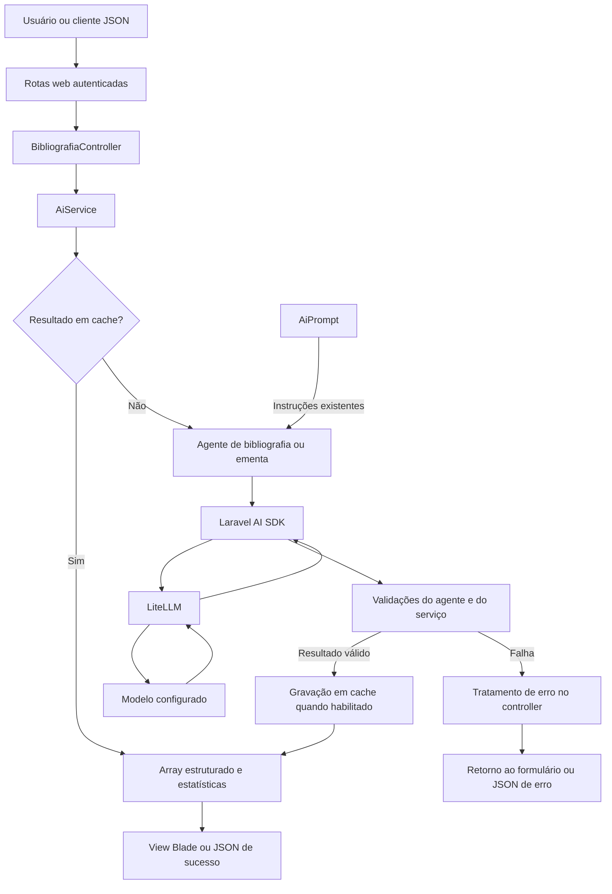
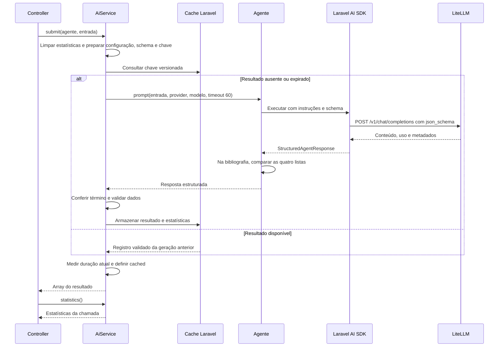

# Implementação do Laravel AI SDK

Este documento explica a integração de bibliografia e revisão de ementas com o Laravel AI SDK a partir do código atual do projeto. Ele descreve as responsabilidades dos arquivos, os contratos de dados, a execução pelo LiteLLM, as validações, o cache, as estatísticas e a apresentação dos resultados.

O [plano de implementação](plano-implementacao-laravel-ai-sdk.md) registra as etapas da migração e suas verificações históricas. Este guia serve como referência para entender e manter a implementação existente.

## Índice

- [1. Visão geral e dependências](#1-visão-geral-e-dependências)
- [2. Organização do código](#2-organização-do-código)
- [3. Configuração do SDK e do LiteLLM](#3-configuração-do-sdk-e-do-litellm)
- [4. Prompts, instruções e entrada do usuário](#4-prompts-instruções-e-entrada-do-usuário)
- [5. Agente de bibliografia](#5-agente-de-bibliografia)
- [6. Agente de ementa](#6-agente-de-ementa)
- [7. Execução compartilhada no AiService](#7-execução-compartilhada-no-aiservice)
- [8. Validação da resposta](#8-validação-da-resposta)
- [9. Cache de respostas](#9-cache-de-respostas)
- [10. Estatísticas](#10-estatísticas)
- [11. Rotas, controllers e contratos públicos](#11-rotas-controllers-e-contratos-públicos)
- [12. Tratamento de falhas](#12-tratamento-de-falhas)
- [13. Apresentação nas telas](#13-apresentação-nas-telas)
- [14. Testes e verificações](#14-testes-e-verificações)
- [15. Orientações para manutenção](#15-orientações-para-manutenção)

## 1. Visão geral e dependências

A integração usa `laravel/ai` com o requisito `^1.2@stable` em [composer.json](../composer.json). A versão registrada no lockfile da migração é 1.2.0. O projeto exige PHP `^8.3` e utiliza Laravel 12; a validação de 13/10/2026 ocorreu com PHP 8.3.33 e Laravel 12.69.3.

Cada POST válido executa um fluxo síncrono: a aplicação aguarda o resultado ou uma falha para responder. Uma entrada já processada pode ser atendida pelo cache sem chamar o modelo novamente.



Os agentes utilizados pelos endpoints não implementam `Conversational` nem `HasTools`. O fluxo não mantém histórico de conversa e não utiliza streaming, filas, embeddings ou RAG. A migração não acrescentou tabelas de conversas nem uma estrutura de persistência de estatísticas.

## 2. Organização do código

| Arquivo | Responsabilidade na integração |
| --- | --- |
| [composer.json](../composer.json) e [composer.lock](../composer.lock) | Declarar a dependência do SDK e registrar as versões instaladas. |
| [config/ai.php](../config/ai.php) | Selecionar provider, driver, URL, chave e modelo de texto. |
| [config/aiService.php](../config/aiService.php) | Definir a retenção do cache de respostas. |
| [config/cache.php](../config/cache.php) | Escolher o armazenamento usado pela facade `Cache`. |
| [app/Models/AiPrompt.php](../app/Models/AiPrompt.php) | Manter os textos originais dos prompts e a lista de normas bibliográficas. |
| [app/Ai/Agents/BibliografiaAgent.php](../app/Ai/Agents/BibliografiaAgent.php) | Fornecer instruções, schema e verificação das quatro listas bibliográficas. |
| [app/Ai/Agents/EmentaAgent.php](../app/Ai/Agents/EmentaAgent.php) | Fornecer instruções e schema da revisão bilíngue. |
| [app/Services/AiService.php](../app/Services/AiService.php) | Executar agentes, validar resultados, administrar cache e normalizar estatísticas. |
| [app/Http/Controllers/BibliografiaController.php](../app/Http/Controllers/BibliografiaController.php) | Validar requisições, criar os agentes e apresentar sucesso ou falha nos dois serviços. |
| [routes/web.php](../routes/web.php) | Registrar os endpoints de bibliografia e ementa com autenticação. |
| [resources/views/bibliografia/index.blade.php](../resources/views/bibliografia/index.blade.php) | Apresentar referências revisadas, explicações e confiança. |
| [resources/views/ementa/index.blade.php](../resources/views/ementa/index.blade.php) | Apresentar nota, análises e textos revisados em português e inglês. |
| [tests/Feature](../tests/Feature) | Verificar configuração, agentes, serviço e respostas HTTP. |

Apesar do nome, `BibliografiaController` contém tanto `bibliografia()` quanto `ementa()`. O Laravel resolve `AiService` pela injeção no construtor do controller. Não há binding específico desse serviço em `AppServiceProvider`.

## 3. Configuração do SDK e do LiteLLM

### 3.1 Variáveis de ambiente

As variáveis da integração estão exemplificadas em [.env.example](../.env.example):

```dotenv
AI_PROVIDER=litellm
LITELLM_URL=http://localhost:4000
LITELLM_API_KEY=
LITELLM_MODEL=gemini-flash
AI_CACHE_RETENTION=604800
```

`gemini-flash` é um exemplo de alias. O valor efetivo deve corresponder a um modelo exposto pelo gateway. O driver usa o protocolo compatível com OpenAI mesmo quando o LiteLLM encaminha a geração a outro fornecedor.

| Variável | Configuração consumida | Efeito |
| --- | --- | --- |
| `AI_PROVIDER` | `ai.default` | Seleciona a conexão de texto; o padrão é `litellm`. |
| `LITELLM_URL` | `ai.providers.litellm.url` | Define a base da API após normalização. |
| `LITELLM_API_KEY` | `ai.providers.litellm.key` | Autentica a chamada ao gateway. |
| `LITELLM_MODEL` | `ai.providers.litellm.models.text.default` | Define o alias enviado no campo `model`. |
| `AI_CACHE_RETENTION` | `aiService.cacheRetention` | Define, em segundos, a retenção dos resultados válidos. |
| `CACHE_DRIVER` | `cache.default` | Escolhe o armazenamento do cache de respostas deste projeto. |

As credenciais são lidas do ambiente pelo arquivo de configuração. O serviço consome `config()`, mantendo a integração compatível com o cache de configuração do Laravel.

### 3.2 Normalização da URL

`config/ai.php` remove barras finais de `LITELLM_URL` com `rtrim()`. Se a base já termina em `/v1`, ela é preservada; caso contrário, o arquivo acrescenta esse segmento. O gateway do SDK acrescenta `/chat/completions` ao executar o agente.

| Entrada em `LITELLM_URL` | Base em `config/ai.php` | Endpoint de geração |
| --- | --- | --- |
| `http://localhost:4000` | `http://localhost:4000/v1` | `http://localhost:4000/v1/chat/completions` |
| `http://localhost:4000/` | `http://localhost:4000/v1` | `http://localhost:4000/v1/chat/completions` |
| `http://localhost:4000/v1/` | `http://localhost:4000/v1` | `http://localhost:4000/v1/chat/completions` |
| `https://gateway.example.com/proxy` | `https://gateway.example.com/proxy/v1` | `https://gateway.example.com/proxy/v1/chat/completions` |

Uma URL vazia permanece `null`, permitindo que a configuração ausente seja detectada. O prefixo `/v1` preserva o endpoint usado pelo projeto antes da migração; ele é uma escolha desta configuração.

### 3.3 Seleção de provider e modelo

`AiService::submit()` obtém o nome da conexão com `Ai::getDefaultInstance()` e resolve seu modelo com `Ai::textProvider($provider)->defaultTextModel()`.

Por isso, o serviço respeita `AI_PROVIDER` e não fixa `litellm` no código de execução. Ao escolher outra conexão, suas credenciais e seu modelo padrão precisam estar configurados de acordo com o driver selecionado. O driver `openai-compatible` exige um modelo de texto padrão nessa utilização do serviço.

Os outros providers e as opções `default_for_*` de `config/ai.php` vieram da configuração publicada pelo SDK. Bibliografia e ementa utilizam apenas a operação de texto. O bloco `caching.embeddings` também pertence ao SDK e não controla o cache de respostas do `AiService`.

## 4. Prompts, instruções e entrada do usuário

`AiPrompt` permanece como fonte dos textos. Os agentes chamam:

```php
// Bibliografia: a norma altera somente a interpolação já existente no prompt.
AiPrompt::systemPrompt('bibliografia', ['standard' => $this->standard]);

// Ementa: utiliza o prompt existente sem parâmetros adicionais.
AiPrompt::systemPrompt('ementa');
```

`systemPrompt()` seleciona o conteúdo pelo identificador do serviço. Na bibliografia, a norma é interpolada no texto original. Na ementa, são preservadas as instruções acadêmicas, a descrição dos campos e o exemplo de JSON.

O conteúdo do usuário é passado separadamente a `prompt($input, ...)`. No driver configurado, o SDK monta uma mensagem `system` com as instruções e uma mensagem `user` com a entrada. Os controllers não concatenam o texto do formulário às instruções e não montam manualmente o envelope Chat Completions.

Os métodos antigos `AiPrompt::render()` e `renderFromPrompt()` continuam no arquivo preservado, mas não são utilizados pelo fluxo migrado. Os controllers ainda obtêm `systemPrompt()` para preencher a chave pública `prompt` no resultado; a execução usa as instruções fornecidas pelo agente.

A migração preservou integralmente `AiPrompt.php`. A comparação com a base anterior à instalação do SDK pode ser repetida com:

```bash
git diff 30cd003 --exit-code -- app/Models/AiPrompt.php
```

O schema complementa essas instruções: ele representa tipos e campos em código, enquanto o prompt descreve o trabalho a realizar e o significado do conteúdo.

## 5. Agente de bibliografia

### 5.1 Interfaces e construção

`BibliografiaAgent` implementa `Laravel\Ai\Contracts\Agent` e `HasStructuredOutput`. O trait `Promptable` oferece a execução pelo SDK.

Seu construtor recebe uma string `$standard`. A validação dessa norma ocorre no controller antes da criação do agente, usando `Rule::in(AiPrompt::getBibliografiaStandards())`.

As opções atuais são:

- `ABNT NBR 6023:2025`;
- `APA 7th Edition`;
- `Vancouver Style`;
- `IEEE Citation Style`.

O construtor não repete essa validação. Quem instanciar o agente fora do controller deve fornecer uma norma adequada ao seu caso de uso.

### 5.2 Schema das quatro listas

`schema()` recebe um construtor de tipos `JsonSchema` do Laravel e retorna as definições dos campos:

| Campo | Tipo e restrições | Uso |
| --- | --- | --- |
| `referencias` | Lista obrigatória de strings. | Referências corrigidas na norma solicitada. |
| `explicacoes` | Lista obrigatória de strings. | Ajustes relativos a cada referência. |
| `busca_dedalus` | Lista obrigatória de objetos com `autor` e `titulo`, ambos strings obrigatórias. | Dados preparados para consulta ao catálogo. |
| `confiancas` | Lista obrigatória de inteiros entre 0 e 100. | Confiança associada a cada referência. |

As quatro listas preservam o formato já descrito no prompt. A associação entre referência, explicação, busca e confiança utiliza o mesmo índice.

Exemplo ilustrativo do array devolvido pelo agente:

```json
{
  "referencias": ["Referência revisada A."],
  "explicacoes": ["Pontuação revisada."],
  "busca_dedalus": [{"autor": "Autor A", "titulo": "Título A"}],
  "confiancas": [90]
}
```

Esse exemplo demonstra o contrato de dados; não representa uma referência validada segundo uma norma acadêmica.

### 5.3 Por que o agente redefine prompt()

O agente declara um alias privado para o método do trait:

```php
use Promptable {
    prompt as private promptViaSdk;
}
```

Seu próprio `prompt()` delega a chamada a `promptViaSdk()`, preservando os argumentos de entrada, anexos, provider, modelo e timeout. Depois da execução, exige uma `StructuredAgentResponse` e chama `validateCorrespondence()`.

`validateCorrespondence()` percorre os quatro campos. Cada campo deve ser um array que satisfaça `array_is_list()`. A primeira lista fornece a contagem de referência para comparar as demais; uma lista ausente, um formato incorreto ou um tamanho diferente gera `RuntimeException`.

Essa validação fica no agente porque o schema descreve cada lista individualmente e não compara comprimentos entre campos. A validação recursiva de tipos e valores é feita pelo serviço antes de armazenar a resposta.

A verificação implementada compara o tamanho das listas de saída. Ela não conta referências na entrada, não comprova a associação semântica entre os itens e não exige listas não vazias. Esses aspectos dependem das instruções e do conteúdo gerado.

## 6. Agente de ementa

`EmentaAgent` também implementa `Agent` e `HasStructuredOutput`, utilizando `Promptable`. Ele não redefine `prompt()`: a execução é a do trait, e as verificações locais de estrutura ficam no `AiService`.

`instructions()` retorna `AiPrompt::systemPrompt('ementa')`. O schema exige três objetos na raiz:

| Caminho | Estrutura obrigatória |
| --- | --- |
| `score.valor` | Inteiro de 0 a 100. |
| `score.justificativa` | String com a justificativa da nota. |
| `explicacoes.pt` | Objeto com três análises em português. |
| `explicacoes.en` | Objeto com as mesmas análises e o status do inglês. |
| `explicacoes.en.status` | String restrita a `presente`, `parcial` ou `ausente`. |
| `texto_revisado.ementa` | Objeto com strings `pt` e `en`. |
| `texto_revisado.objetivos` | Objeto com strings `pt` e `en`. |
| `texto_revisado.conteudo_programatico` | Objeto com strings `pt` e `en`. |

As três análises têm os nomes `gramatica_acentuacao_pontuacao`, `redacao_academica_clareza_pedagogica` e `terminologia_tecnica`. O código reúne suas definições em `$analysisFields`, reutilizando-as em português e inglês. O status é acrescentado somente ao objeto inglês.

Da mesma forma, `$bilingualFields` reúne as definições de `pt` e `en` para reutilização nas três seções revisadas. Todos os objetos e campos descritos acima são marcados com `required()`.

Exemplo ilustrativo de resposta:

```json
{
  "score": {"valor": 90, "justificativa": "Texto claro, com ajustes de pontuação."},
  "explicacoes": {
    "pt": {
      "gramatica_acentuacao_pontuacao": "Pontuação revisada.",
      "redacao_academica_clareza_pedagogica": "Objetivos apresentados com clareza.",
      "terminologia_tecnica": "Terminologia consistente."
    },
    "en": {
      "status": "ausente",
      "gramatica_acentuacao_pontuacao": "Tradução criada.",
      "redacao_academica_clareza_pedagogica": "Texto organizado em inglês acadêmico.",
      "terminologia_tecnica": "Terminologia traduzida."
    }
  },
  "texto_revisado": {
    "ementa": {"pt": "Introdução à programação.", "en": "Introduction to programming."},
    "objetivos": {"pt": "Desenvolver algoritmos.", "en": "Develop algorithms."},
    "conteudo_programatico": {"pt": "Variáveis e funções.", "en": "Variables and functions."}
  }
}
```

Mesmo com status `ausente`, o contrato exige campos de texto em ambos os idiomas. O prompt orienta o modelo a produzir a tradução quando necessário. O schema exige strings, mas não estabelece tamanho mínimo nem mede a qualidade da tradução.

## 7. Execução compartilhada no AiService

### 7.1 Contrato do serviço

A interface pública é `submit(Agent $agent, string $input): array`. Em tempo de execução, o serviço exige que o agente também implemente `HasStructuredOutput`.

O retorno contém somente os dados estruturados. Os metadados ficam disponíveis por `statistics(): ?array`. Isso permite que o controller mapeie o resultado para o contrato existente das telas sem depender diretamente do objeto de resposta do SDK.

O construtor carrega `aiService.cacheRetention`, convertendo o valor para inteiro. Essa retenção pertence à instância do serviço; alterar a configuração depois da construção não altera o valor já carregado.

### 7.2 Preparação de cada execução

Antes de consultar o cache, `submit()` realiza quatro ações:

1. Limpa `$statistics` para impedir que uma falha deixe dados de uma chamada anterior disponíveis.
2. Marca o início com `microtime(true)`.
3. Verifica `HasStructuredOutput` e resolve provider e modelo.
4. Serializa o schema com `ObjectSchema` e calcula a chave de cache.

O schema serializado participa tanto da chave quanto da validação local. A preparação ocorre mesmo quando a retenção está desabilitada ou a chamada termina em um acerto de cache.

### 7.3 Geração quando o resultado não está em cache

O serviço define uma closure `$generate`, responsável pela execução e preparação do registro a armazenar. Ela muda `$wasCached` para `false` e chama:

```php
// Provider e modelo foram resolvidos a partir de config/ai.php.
$response = $agent->prompt($input, provider: $provider, model: $model, timeout: 60);
```

O timeout de 60 segundos é entregue ao SDK para a chamada ao provider. O tempo total medido pelo serviço também inclui preparação, validação e operações de cache.

O SDK consulta `instructions()` e `schema()`, monta a requisição do driver `openai-compatible`, envia-a ao LiteLLM e fornece uma resposta estruturada com uso e metadados.

Neste driver, a requisição inclui `response_format.type = json_schema` e o schema em `response_format.json_schema.schema`. `ObjectSchema` desabilita propriedades adicionais nos objetos, inclusive os aninhados. Os agentes atuais não possuem o atributo `Strict`; no SDK instalado, o parâmetro enviado `response_format.json_schema.strict` é `false`. Os campos obrigatórios e as restrições continuam presentes no schema, e a aplicação faz sua própria validação.

O gateway e o modelo precisam aceitar esse formato de saída. Os controllers não fazem `json_decode()` da resposta: `StructuredAgentResponse::toArray()` fornece os dados decodificados pelo SDK.

### 7.4 Caminho completo, com repetição em cache



O diagrama mostra o caso com retenção positiva. Com retenção zero ou negativa, o serviço chama `$generate()` diretamente e não consulta nem grava o cache.

## 8. Validação da resposta

### 8.1 Verificações antes de armazenar

A closure de geração exige que a resposta seja uma `StructuredAgentResponse`. Em seguida, consulta `steps->last()?->finishReason` e aceita somente `FinishReason::Stop`.

Uma resposta truncada, filtrada ou sem motivo de término normal é rejeitada, mesmo que seu conteúdo seja JSON decodificável. Depois disso, `toArray()` fornece os dados para `validateValue()`.

Na bibliografia, `validateCorrespondence()` já foi executado pelo agente antes de a resposta chegar a essas verificações do serviço.

### 8.2 Validação recursiva

`validateValue()` percorre o schema e verifica os tipos utilizados pelos agentes atuais:

| Tipo | Verificação no PHP |
| --- | --- |
| `object` | Array associativo, ou array vazio sujeito à verificação dos campos obrigatórios. |
| `array` | Array com índices de lista, conferido por `array_is_list()`. |
| `string` | Valor aceito por `is_string()`. |
| `integer` | Valor aceito por `is_int()`. |

O método também verifica `enum` com comparação estrita, `minimum`, `maximum`, campos em `required` e propriedades extras quando `additionalProperties` é `false`.

Para objetos, percorre suas propriedades e chama a si mesmo para cada campo presente. Para arrays, valida cada item contra `items`. Um inteiro representado como string, como `"90"`, não passa pela verificação de um campo inteiro.

As mensagens internas identificam caminhos como `resposta.confiancas.0` ou `resposta.texto_revisado.ementa.en`, sem incorporar o valor enviado. O controller converte essas falhas para mensagens públicas próprias.

### 8.3 Alcance das validações

O validador cobre os tipos e restrições usados hoje. Tipos como `boolean` e `number` são rejeitados; restrições adicionais como `minLength` e `minItems` não são verificadas por esse método. Novos contratos precisam de suporte explícito no serviço.

A validação local comprova estrutura, tipos, limites e a igualdade de tamanho das listas bibliográficas. A correção acadêmica, a fidelidade da tradução e o atendimento das instruções de redação dependem do conteúdo produzido pelo modelo.

O plano registra um exemplo dessa diferença: uma resposta APA tinha estrutura válida, mas as explicações começaram com uma introdução genérica, apesar da instrução original de fornecer explicações diretas.

## 9. Cache de respostas

### 9.1 Composição da chave

A chave começa com `ai:submit:v2:` e termina com um hash SHA-256 de um JSON contendo:

| Componente | Motivo de participar da chave |
| --- | --- |
| Classe do agente | Separa serviços e implementações diferentes. |
| Instruções | Separa prompts e normas bibliográficas diferentes. |
| Schema serializado | Evita reutilizar um resultado de outro contrato de saída. |
| Nome do provider | Separa conexões selecionadas. |
| Configuração completa do provider | Separa mudanças de URL, credencial e demais opções da conexão. |
| Modelo padrão resolvido | Separa aliases ou modelos configurados. |
| Entrada do usuário | Separa os textos processados. |

`JSON_THROW_ON_ERROR` evita produzir a chave a partir de uma serialização que falhou. URL, chave e texto participam do hash, mas seus valores literais não aparecem na chave final.

O identificador do usuário não participa da chave. O reaproveitamento é compartilhado entre usuários com o mesmo agente, instruções, schema, conexão, modelo e texto. Uma alteração do backend do LiteLLM sob o mesmo alias, sem mudar essa configuração, também não altera a chave; nesse caso, resultados anteriores podem permanecer até sua expiração.

### 9.2 Conteúdo armazenado

O cache guarda um array simples com duas partes:

```text
registro
├── result: dados estruturados validados
└── statistics
    ├── usage: prompt_tokens, completion_tokens e total_tokens
    ├── provider
    ├── model
    ├── id
    ├── finish_reason
    └── cached_at
```

O objeto `StructuredAgentResponse`, a resposta HTTP completa e o histórico de mensagens não são armazenados nesse registro. Os textos gerados fazem parte de `result` e são persistidos conforme o armazenamento escolhido no Laravel.

### 9.3 Retenção e acerto de cache

Com retenção positiva, o serviço usa `Cache::remember()` com expiração calculada por `now()->addSeconds($this->cacheRetention)`. O padrão é 604800 segundos, equivalente a sete dias.

Em um acerto de cache, `$generate` não é executada, `$wasCached` permanece `true` e os dados armazenados são devolvidos. O serviço não revalida esse registro em cada leitura: ele reutiliza um resultado que passou pelas validações na geração original.

O timestamp original `cached_at` e o uso de tokens são preservados. A duração é recalculada para a chamada atual. A leitura não renova a expiração do registro.

Com retenção zero ou negativa, o cache inteiro dessa operação é ignorado, inclusive registros existentes. Toda chamada segue pela geração.

### 9.4 Falhas e chamadas simultâneas

O registro só é devolvido pela closure depois de todas as validações. Se o provider falhar ou a resposta for rejeitada, a closure lança uma exceção e `Cache::remember()` não armazena o resultado daquela execução. Uma nova tentativa pode gerar uma resposta válida.

A implementação não acrescenta lock à geração. Duas requisições simultâneas que encontrem a mesma chave ausente podem executar o modelo antes de uma delas gravar o resultado. O cache reaproveita respostas concluídas, mas não garante uma única geração para chamadas concorrentes.

## 10. Estatísticas

`statistics()` descreve a última execução bem-sucedida da instância de `AiService`. Retorna `null` antes do primeiro sucesso e depois de uma chamada que falhou, porque o estado é limpo no início de `submit()`.

| Campo | Origem e significado |
| --- | --- |
| `usage.prompt_tokens` | `$response->usage->inputTokens`: tokens de entrada informados pelo SDK. |
| `usage.completion_tokens` | `$response->usage->outputTokens`: tokens de saída informados pelo SDK. |
| `usage.total_tokens` | `$response->usage->totalTokens()`: total normalizado pelo SDK. |
| `provider` | Metadado da resposta, com fallback para o provider selecionado. |
| `model` | Metadado da resposta, com fallback para o modelo configurado; pode indicar o modelo efetivo devolvido pelo gateway. |
| `id` | Campo `id` da resposta HTTP bruta, com fallback para `invocationId` do SDK. |
| `finish_reason` | Valor do término aceito: `stop`. |
| `cached_at` | Data da geração original em formato ISO 8601. |
| `duration` | Tempo da chamada atual em segundos, arredondado para duas casas decimais. |
| `cached` | `true` quando o resultado veio do cache; `false` quando houve geração. |

`cached_at` é preenchido após uma geração válida mesmo com retenção desabilitada. Ele representa a data da geração; o campo `cached` é que informa se a chamada atual reutilizou o cache.

Em um acerto, o uso continua representando os tokens da geração original. Isso permite que a tela indique a economia por reaproveitamento. Essas estatísticas não constituem um acumulado de consumo ou faturamento e não são gravadas em uma tabela própria.

## 11. Rotas, controllers e contratos públicos

### 11.1 Entrada HTTP

As rotas estão em `routes/web.php`, dentro do middleware `auth` e do grupo web:

| Endpoint | Nome da rota | Campos obrigatórios no POST |
| --- | --- | --- |
| `/bibliografia` | `bibliografia.bibliografia` | `message`: string de até 10.000 caracteres; `standard`: uma das normas disponíveis. |
| `/ementa` | `bibliografia.ementa` | `mensagem`: string de até 10.000 caracteres. |

Os formulários incluem `@csrf`. Um cliente JSON utiliza a sessão autenticada e o token CSRF correspondente. Esses endpoints não são registrados como rotas da API em `routes/api.php`.

GET retorna o formulário. Com `Accept: application/json`, `wantsJson()` retorna verdadeiro e o controller responde com instruções dos campos do POST. Esse caminho não executa o agente nem consulta o provider.

No POST, a validação do Laravel ocorre antes do bloco de execução de IA. Uma entrada inválida segue o tratamento padrão de validação, sem chamar o serviço; no JSON, retorna 422. A autenticação também é aplicada antes do controller, com 401 para uma requisição JSON não autenticada.

### 11.2 Seleção do agente

Depois de validar a entrada, os métodos do controller executam:

```php
// bibliografia(): recebe a norma validada e o texto do campo message.
$resultado = $this->aiService->submit(new BibliografiaAgent($standard), $referencias);

// ementa(): recebe o texto do campo mensagem.
$resultado = $this->aiService->submit(new EmentaAgent, $mensagem);
```

O controller consome o array devolvido e chama `statistics()` no mesmo serviço. O resultado bem-sucedido segue para uma view ou para `response()->json()`, conforme `wantsJson()`.

### 11.3 Contrato público da bibliografia

O envelope JSON de sucesso é `{"success": true, "data": {...}}`, com HTTP 200. A view recebe o mesmo array de apresentação:

| Campo em `data` | Origem |
| --- | --- |
| `referencias` | Texto original recebido em `message`. |
| `respostas` | Lista `referencias` do resultado do agente. |
| `explicacoes` | Lista `explicacoes` do resultado. |
| `confiancas` | Lista `confiancas` do resultado. |
| `estatisticas` | `AiService::statistics()`. |
| `prompt` | Prompt original com a norma interpolada. |
| `standards` | Lista completa de normas disponíveis. |
| `standard` | Norma selecionada. |

Os nomes têm significados diferentes nas duas camadas: `referencias` no resultado do agente contém o texto corrigido; `data.referencias` contém a entrada original, e `data.respostas` contém a correção.

`busca_dedalus` faz parte do schema, é validado e pode ficar no cache, mas o controller atual não o inclui nos dados da view nem no JSON público. O agente prepara esses dados; o fluxo atual não realiza uma consulta ao catálogo.

### 11.4 Contrato público da ementa

O envelope de sucesso também usa `success` e `data`, com HTTP 200:

| Campo em `data` | Origem |
| --- | --- |
| `mensagem` | Texto original recebido. |
| `resposta` | Objeto `texto_revisado` do resultado do agente. |
| `explicacoes` | Objeto `explicacoes` do resultado. |
| `analiseIngles` | Objeto `explicacoes.en`, preservando a chave pública existente. |
| `score` | Objeto `score` do resultado. |
| `estatisticas` | `AiService::statistics()`. |
| `prompt` | Prompt original de ementa. |

O controller não procura `analise_ingles` na resposta do modelo: esse campo não pertence ao schema. A análise do inglês é obtida de `explicacoes.en`.

## 12. Tratamento de falhas

### 12.1 Onde as falhas são capturadas

Os dois métodos do controller envolvem somente a chamada do serviço em `try/catch`. Capturam `AiException`, `RequestException`, `ConnectionException`, `RuntimeException`, `InvalidArgumentException` e `JsonException`, encaminhando-as a `aiFailureResponse()`.

A validação da entrada continua sob responsabilidade do Laravel. O serviço propaga falhas de configuração, execução ou resposta inválida; ele não devolve um resultado parcial nem reutiliza uma resposta anterior como fallback.

### 12.2 Classificação e mensagens públicas

`aiFailureResponse()` aplica um `match (true)`. A detecção de timeout vem primeiro, seguida das categorias específicas e, por último, dos erros genéricos.

| Situação identificada | HTTP no JSON | Mensagem |
| --- | --- | --- |
| Timeout | 504 | O serviço de IA não respondeu a tempo. Tente novamente. |
| `RateLimitedException` | 429 | O serviço de IA atingiu o limite de solicitações. Aguarde e tente novamente. |
| `ProviderConnectionException` ou `ConnectionException` | 503 | Não foi possível conectar ao serviço de IA. Tente novamente mais tarde. |
| `ProviderOverloadedException`, `InsufficientCreditsException`, `InvalidArgumentException` ou `JsonException` | 503 | O serviço de IA está indisponível no momento. Tente novamente mais tarde. |
| `RuntimeException` | 502 | A IA retornou uma resposta inválida ou incompleta. Tente novamente. |
| Demais falhas capturadas | 502 | Não foi possível processar a solicitação no serviço de IA. Tente novamente. |

`isTimeout()` percorre a cadeia de causas com `getPrevious()`. Reconhece `ConnectException` com código cURL 28 e `RequestException` com status HTTP 408 ou 504. Isso permite identificar timeout mesmo quando o SDK envolve a exceção original.

Os status do provider não são copiados indiscriminadamente. Por exemplo, os testes verificam que HTTP 402 do provider resulta em 503 público e que HTTP 500 resulta em 502 público.

### 12.3 Formato JSON, retorno web e logs

Para JSON, a resposta de falha contém somente:

```json
{
  "success": false,
  "message": "O serviço de IA não respondeu a tempo. Tente novamente."
}
```

Na web, o controller redireciona para a mesma rota, usa `withErrors(['ai' => $message])` e preserva somente os campos `message`, `standard` e `mensagem` com `withInput()`. O tema exibe o alerta e os formulários recuperam os valores com `old()`.

O registro feito por esse tratamento usa `Log::warning()` com uma mensagem fixa e dois campos: `exception_type`, com a classe da exceção, e `route`, com o nome da rota. Esse registro não copia o conteúdo enviado, a mensagem interna do provider ou as credenciais. A resposta pública também usa mensagens próprias, inclusive quando `app.debug` está habilitado.

## 13. Apresentação nas telas

### 13.1 Bibliografia

`bibliografia.index` apresenta a entrada original no formulário e as referências corrigidas em um painel editável. Outro painel contém explicações e percentuais de confiança, associados pelo índice das listas.

As referências e as explicações usam a sintaxe escapada do Blade. O formulário recupera `old('message')`, correspondente ao nome enviado no POST, e `old('standard')` para manter a norma selecionada após uma falha.

O percentual controla a cor do badge: valores a partir de 89 usam sucesso; a partir de 64, aviso; os demais, perigo. Essa é uma regra de apresentação aplicada depois da validação de confiança entre 0 e 100.

### 13.2 Ementa

`ementa.index` apresenta a nota e sua justificativa, as três análises em ambos os idiomas e o texto revisado de ementa, objetivos e conteúdo programático.

Os seis campos de texto revisado são renderizados com `nl2br(e(...))`: `e()` escapa HTML e `nl2br()` mantém as quebras de linha. Assim, uma marcação produzida pelo modelo é apresentada como texto.

O partial `ementa.partials.ingles-presente-badge` lê `explicacoes.en.status`. Usa a aparência de sucesso para `presente` e de aviso para os outros estados.

### 13.3 Estatísticas e comportamento no navegador

As duas telas reutilizam `bibliografia.partials.estatisticas`. Quando houve geração, ele mostra duração e tokens; quando houve acerto de cache, mostra a indicação de cache e os tokens economizados por reutilização.

Os partials compartilhados `height-sync`, `diff-viewer` e `cross-highlight` fornecem os comportamentos de sincronização de altura, comparação entre original e revisão e destaque associado às explicações. Os scripts das telas inicializam esses comportamentos após `DOMContentLoaded` e recalculam o diff ao editar o resultado.

Essas interações são executadas no navegador depois da resposta HTTP. Os testes de apresentação existentes verificam o HTML renderizado, mas não executam as interações JavaScript.

## 14. Testes e verificações

### 14.1 Estratégia usada na implementação

Os testes combinam duas formas de simulação. `Http::fake()` mantém a execução do agente e a montagem da requisição pelo SDK, substituindo a resposta do provider. Os fakes nativos, como `EmentaAgent::fake()`, fornecem dados estruturados sem depender de uma resposta HTTP bruta.

Os testes específicos de IA usam `Http::preventStrayRequests()` para impedir chamadas HTTP não simuladas. O cache é configurado em memória. Os testes dos controllers utilizam usuários em memória, sem cadastrar usuários no banco local; a renderização também neutraliza menus que poderiam consultar permissões no banco.

Os testes dos controllers usam HTTP simulado. Os fakes nativos do SDK verificam comportamentos dos agentes e do serviço, inclusive `assertPrompted()` e a contagem de execuções em uma repetição atendida pelo cache.

### 14.2 Cobertura por arquivo

| Arquivo de teste | Verificações principais |
| --- | --- |
| [AiSdkConfigurationTest.php](../tests/Feature/AiSdkConfigurationTest.php) | Normalização de URL com e sem `/v1`, barra final e caminho adicional; configuração ausente; autenticação HTTP; modelo; envio de `json_schema`; conversão da resposta estruturada. |
| [BibliografiaAgentTest.php](../tests/Feature/BibliografiaAgentTest.php) | Prompt original nas quatro normas; separação de mensagens system/user; schema obrigatório; confiança 0–100; ausência de tools e conversa; rejeição de listas ausentes, inválidas ou de tamanhos diferentes. |
| [EmentaAgentTest.php](../tests/Feature/EmentaAgentTest.php) | Preservação do prompt; estrutura aninhada; versões `pt` e `en`; estados do inglês; notas extremas; metadados; uso dos fakes nativos. |
| [AiServiceTest.php](../tests/Feature/AiServiceTest.php) | Timeout 60; estatísticas; cache entre instâncias; expiração; retenção zero; separação por entrada, norma, agente, conexão, instruções e schema; provider selecionado; respostas inválidas não armazenadas; limpeza das estatísticas; fakes sem resposta HTTP bruta; contratos JSON dos controllers. |
| [AiControllerTest.php](../tests/Feature/AiControllerTest.php) | Falhas HTTP, conexão e timeout; configuração ausente; resposta inválida; mensagens sanitizadas; validação da entrada; autenticação; preservação de formulário; renderização web; JSON e acerto de cache; escape de HTML; instruções de GET. |

Os testes de ementa com inglês presente, parcial e ausente simulam as respostas correspondentes. Eles comprovam que o contrato e a integração aceitam essas estruturas; a avaliação linguística do modelo é uma verificação separada.

### 14.3 Comandos para repetir as verificações

Na raiz do projeto, com as dependências instaladas:

```bash
# Executa as suítes Unit e Feature configuradas no phpunit.xml.
vendor/bin/phpunit

# Executa somente os testes específicos desta integração.
vendor/bin/phpunit tests/Feature/AiSdkConfigurationTest.php tests/Feature/BibliografiaAgentTest.php tests/Feature/EmentaAgentTest.php tests/Feature/AiServiceTest.php tests/Feature/AiControllerTest.php

# Verifica a consistência das dependências e os requisitos do ambiente instalado.
composer validate --no-check-publish
composer check-platform-reqs

# Confere a inicialização e o middleware das rotas.
php artisan --version
php artisan route:list --path=bibliografia -v
php artisan route:list --path=ementa -v
```

Na validação de 13/10/2026, a suíte completa passou com **82 testes e 589 assertions**. A validação do Composer, os requisitos da plataforma e a inicialização também passaram. As rotas mantiveram os middlewares web e de autenticação.

### 14.4 Verificações históricas com provider real

O plano registra uma chamada inicial com um schema pequeno e quatro chamadas posteriores pelo `AiService` em 09/10/2026: bibliografia ABNT e APA, ementa com inglês ausente e ementa com inglês presente. As quatro chamadas posteriores somaram 5715 tokens, e as repetições utilizaram cache em memória.

Esses valores são resultados históricos registrados no plano. A validação automatizada de 13/10/2026 usou simulações e não repetiu chamadas ao provider real. Os testes web comprovam renderização HTTP com dados simulados; não constituem uma execução das telas com um modelo real nem uma avaliação automatizada da qualidade acadêmica.

## 15. Orientações para manutenção

### 15.1 Usar o serviço ou executar o agente diretamente

Para o fluxo completo da aplicação, use `AiService`:

```php
use App\Ai\Agents\BibliografiaAgent;
use App\Ai\Agents\EmentaAgent;
use App\Services\AiService;

$service = app(AiService::class);

// A norma e o texto devem ter sido validados pelo chamador.
$bibliografia = $service->submit(new BibliografiaAgent('APA 7th Edition'), $referencias);
$estatisticasBibliografia = $service->statistics();

// Capture as estatísticas antes da próxima chamada: elas representam a última execução.
$ementa = $service->submit(new EmentaAgent, $mensagem);
$estatisticasEmenta = $service->statistics();
```

Executar `$agent->prompt()` diretamente fornece a resposta do SDK, mas não passa pelo cache, pela normalização das estatísticas nem pela validação recursiva do serviço. No caso de bibliografia, a correspondência das listas continua sendo verificada pelo método do agente. Na ementa, a validação local descrita neste guia depende da passagem pelo serviço.

### 15.2 Evoluir schemas e regras de negócio

Para alterar o contrato de um agente, examine em conjunto o prompt em `AiPrompt`, o schema do agente, o validador do serviço, o mapeamento do controller e os campos utilizados nas views. Atualize os testes dos limites, campos obrigatórios e respostas inválidas, além das verificações de sucesso.

Uma alteração do schema já modifica a chave de cache. Uma mudança somente na lógica de validação, sem alterar o schema ou as instruções, não modifica essa chave; como os acertos não são revalidados, pode ser necessário alterar a versão do prefixo para evitar reutilizar registros validados sob regras anteriores.

Os prompts foram preservados como requisito da migração. Uma mudança futura de instruções deve ser tratada explicitamente e acompanhada da avaliação de conteúdo, além da compatibilidade estrutural.

### 15.3 Configuração e diagnóstico

Ao diagnosticar uma integração, confira primeiro `ai.default`, a configuração da conexão selecionada e seu modelo padrão. Para o LiteLLM, confira também a normalização da URL e o suporte do gateway e do modelo a `json_schema`.

Uma falha de configuração pode acontecer antes da consulta ao cache, porque provider, modelo e schema são preparados no início de `submit()`. Para simulações locais, use os testes existentes; para uma verificação real, utilize conteúdo de teste e examine o array retornado e `statistics()`.

O controle da retenção fica em `config/aiService.php`, e o armazenamento efetivo é selecionado por `CACHE_DRIVER` em `config/cache.php`. Alterações em `.env` devem ser refletidas no cache de configuração do ambiente, conforme o procedimento de implantação utilizado.

Este guia descreve as regras implementadas hoje. Ao mudar comportamento, contratos ou configuração, mantenha-o atualizado junto com o README e os testes correspondentes.
