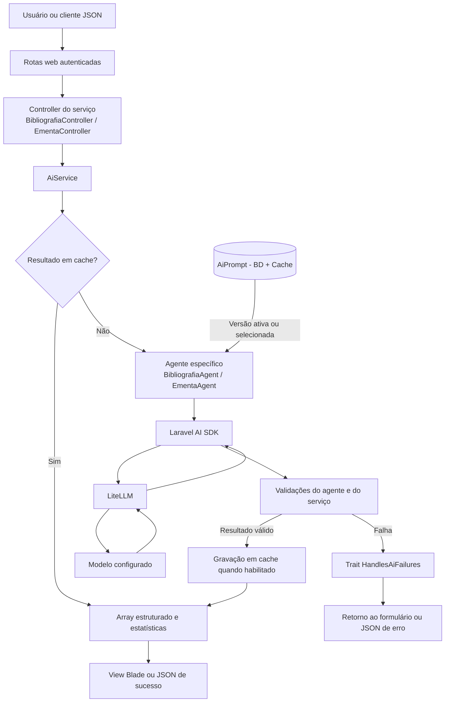
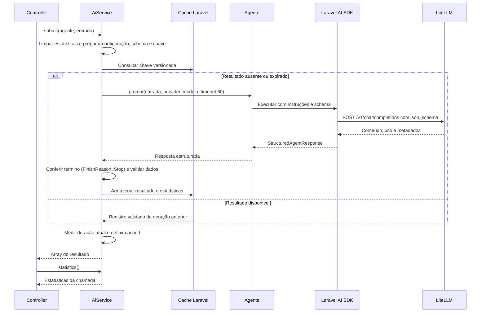

# Arquitetura Geral e Integração com o Laravel AI SDK

Este documento descreve a arquitetura geral de integração da plataforma com o Laravel AI SDK, abordando a configuração do gateway LiteLLM, o versionamento de prompts em banco de dados, a execução compartilhada no `AiService`, a validação estruturada, o cache de respostas, as estatísticas, o tratamento de falhas e a suíte de testes.

Para os detalhes específicos de cada serviço, consulte:

- **[Documentação do Serviço de Bibliografia](bibliografia.md)** (`BibliografiaController`, `BibliografiaAgent` e `DedalusService`)
- **[Documentação do Serviço de Ementa](ementa.md)** (`EmentaController` e `EmentaAgent`)
- **[Documentação do Serviço de Elaboração de Texto](texto.md)** (`TextoController` e `TextoAgent`)

## Índice

- [1. Visão geral e dependências](#1-visão-geral-e-dependências)
- [2. Organização do código](#2-organização-do-código)
- [3. Configuração do SDK e do LiteLLM](#3-configuração-do-sdk-e-do-litellm)
- [4. Versionamento de prompts no banco de dados](#4-versionamento-de-prompts-no-banco-de-dados)
- [5. Execução compartilhada no AiService](#5-execução-compartilhada-no-aiservice)
- [6. Validação da resposta](#6-validação-da-resposta)
- [7. Cache de respostas](#7-cache-de-respostas)
- [8. Estatísticas](#8-estatísticas)
- [9. Tratamento de falhas](#9-tratamento-de-falhas)
- [10. Componentes compartilhados de interface](#10-componentes-compartilhados-de-interface)
- [11. Testes e verificações](#11-testes-e-verificações)
- [12. Orientações para manutenção e novos agentes](#12-orientações-para-manutenção-e-novos-agentes)

---

## 1. Visão geral e dependências

A integração utiliza `laravel/ai` (`^1.2@stable`) em [composer.json](../composer.json) sobre PHP `^8.3` e Laravel 12.

Cada requisição `POST` válida executa um fluxo síncrono: a aplicação valida os parâmetros de entrada, resolve o agente correspondente, busca a versão ativa do prompt no banco de dados (ou utiliza o template padrão em código como fallback), e aguarda a resposta estruturada do gateway ou uma falha tratada. Uma entrada já processada sob a mesma versão de prompt, schema e modelo é atendida diretamente pelo cache.



Os agentes implementam `Laravel\Ai\Contracts\Agent` e `HasStructuredOutput`, sem utilizar `Conversational` nem `HasTools`. O fluxo é independente por requisição, sem histórico de conversa, streaming ou filas.

---

## 2. Organização do código

| Arquivo | Responsabilidade na arquitetura |
| --- | --- |
| [composer.json](../composer.json) e [composer.lock](../composer.lock) | Declarar a dependência do SDK e registrar as versões instaladas. |
| [config/ai.php](../config/ai.php) | Selecionar provider, driver, URL, chave e modelo de texto. |
| [config/aiService.php](../config/aiService.php) | Definir a retenção do cache de respostas (`AI_CACHE_RETENTION`). |
| [app/Enums/PromptStatus.php](../app/Enums/PromptStatus.php) | Enum com o ciclo de vida das versões de prompt (`draft`, `active`, `archived`). |
| [app/Models/AiPrompt.php](../app/Models/AiPrompt.php) | Model Eloquent agnóstico para persistência, versionamento, cache e interpolação de prompts. |
| [database/migrations/2026_10_19_000000_create_ai_prompts_table.php](../database/migrations/2026_10_19_000000_create_ai_prompts_table.php) | Criar a tabela única `ai_prompts` com controle de `slug`, `version` e `status`. |
| [database/seeders/AiPromptSeeder.php](../database/seeders/AiPromptSeeder.php) | Popular de forma idempotente a versão inicial (`v1`) dos prompts no banco. |
| [app/Ai/Agents/BibliografiaAgent.php](../app/Ai/Agents/BibliografiaAgent.php) | Agente de bibliografia: normas suportadas, template padrão, schema e validação das quatro listas. |
| [app/Ai/Agents/EmentaAgent.php](../app/Ai/Agents/EmentaAgent.php) | Agente de ementa: template padrão e schema de revisão bilíngue. |
| [app/Ai/Agents/TextoAgent.php](../app/Ai/Agents/TextoAgent.php) | Agente de elaboração de textos: estilos suportados, template padrão e schema de perguntas/texto elaborado. |
| [app/Services/AiService.php](../app/Services/AiService.php) | Executar agentes estruturados, validar resultados, administrar cache e normalizar estatísticas. |
| [app/Traits/HandlesAiFailures.php](../app/Traits/HandlesAiFailures.php) | Trait compartilhada entre controllers para converter exceções da IA em respostas web/JSON seguras. |
| [app/Http/Controllers/BibliografiaController.php](../app/Http/Controllers/BibliografiaController.php) | Validar e atender requisições de `/bibliografia` (`bibliografia.index`). |
| [app/Http/Controllers/EmentaController.php](../app/Http/Controllers/EmentaController.php) | Validar e atender requisições de `/ementa` (`ementa.index`). |
| [app/Http/Controllers/TextoController.php](../app/Http/Controllers/TextoController.php) | Validar e atender requisições de `/texto` (`texto.index`). |
| [app/Http/Controllers/AiPromptController.php](../app/Http/Controllers/AiPromptController.php) | Gerenciar listagem, edição, versionamento e ativação de prompts em `/settings/prompts` (`can:manager`). |
| [routes/web.php](../routes/web.php) | Registrar as rotas autenticadas dos serviços e o grupo `settings/prompts`. |
| [tests/Feature](../tests/Feature) | Verificar configuração, versionamento e CRUD de prompts, agentes, serviço e respostas HTTP. |

---

## 3. Configuração do SDK e do LiteLLM

### 3.1 Variáveis de ambiente

As variáveis da integração estão exemplificadas em [.env.example](../.env.example):

```dotenv
AI_PROVIDER=litellm
LITELLM_URL=http://localhost:4000
LITELLM_API_KEY=
LITELLM_MODEL=gemini-flash
AI_CACHE_RETENTION=604800
```

| Variável | Configuração consumida | Efeito |
| --- | --- | --- |
| `AI_PROVIDER` | `ai.default` | Seleciona a conexão de texto; o padrão é `litellm`. |
| `LITELLM_URL` | `ai.providers.litellm.url` | Define a base da API após normalização. |
| `LITELLM_API_KEY` | `ai.providers.litellm.key` | Autentica a chamada ao gateway. |
| `LITELLM_MODEL` | `ai.providers.litellm.models.text.default` | Define o alias enviado no campo `model`. |
| `AI_CACHE_RETENTION` | `aiService.cacheRetention` | Define, em segundos, a retenção dos resultados válidos. |
| `CACHE_DRIVER` | `cache.default` | Escolhe o armazenamento do cache de respostas e de prompts. |

### 3.2 Normalização da URL

`config/ai.php` remove barras finais de `LITELLM_URL` com `rtrim()`. Se a base já termina em `/v1`, ela é preservada; caso contrário, o arquivo acrescenta esse segmento. O gateway do SDK acrescenta `/chat/completions` ao executar o agente.

| Entrada em `LITELLM_URL` | Base em `config/ai.php` | Endpoint de geração |
| --- | --- | --- |
| `http://localhost:4000` | `http://localhost:4000/v1` | `http://localhost:4000/v1/chat/completions` |
| `http://localhost:4000/` | `http://localhost:4000/v1` | `http://localhost:4000/v1/chat/completions` |
| `http://localhost:4000/v1/` | `http://localhost:4000/v1` | `http://localhost:4000/v1/chat/completions` |
| `https://gateway.example.com/proxy` | `https://gateway.example.com/proxy/v1` | `https://gateway.example.com/proxy/v1/chat/completions` |

### 3.3 Seleção de provider e modelo

`AiService::submit()` obtém o nome da conexão com `Ai::getDefaultInstance()` e resolve seu modelo com `Ai::textProvider($provider)->defaultTextModel()`.

---

## 4. Versionamento de prompts no banco de dados

Os prompts são armazenados na tabela única `ai_prompts`, gerenciada pelo model [`AiPrompt`](../app/Models/AiPrompt.php) e pelo enum [`PromptStatus`](../app/Enums/PromptStatus.php).

### 4.1 Ciclo de vida (`PromptStatus`)

| Status | Significado | Comportamento |
| --- | --- | --- |
| `draft` (`PromptStatus::Draft`) | **Rascunho (Futura)** | Versão em elaboração ou homologação. Pode ser testada informando explicitamente seu número de versão, sem afetar a produção. |
| `active` (`PromptStatus::Active`) | **Ativa (Produção)** | Versão oficial utilizada por padrão nas chamadas do serviço. Existe apenas uma versão `active` por `slug`. |
| `archived` (`PromptStatus::Archived`) | **Arquivada (Passada)** | Versão anterior substituída e preservada para histórico, auditoria e rollback imediato. |

### 4.2 Operações de evolução e rollback

```php
use App\Models\AiPrompt;

// 1. Obter a versão ativa atual de um serviço:
$v1 = AiPrompt::findActive('ementa');

// 2. Criar uma nova versão futura (draft) a partir da atual:
$v2 = $v1->createNextDraft('Ajuste nas diretrizes de tradução técnica.');
$v2->update(['system_prompt' => '...novo texto do prompt...']);

// 3. Promover a v2 para produção (arquiva automaticamente a v1 e limpa o cache):
$v2->activate();

// 4. Rollback imediato para a v1 se necessário:
$v1->activate();
```

### 4.3 Resolução e fallback (`AiPrompt::resolve`)

Os agentes resolvem suas instruções por meio de `AiPrompt::resolve($slug, $fallbackTemplate, $params, $version)`:

1. Se `$version` for informado (ex.: `new EmentaAgent(version: 2)`), busca especificamente aquela versão no banco (inclusive se estiver em `draft`).
2. Se `$version` for `null`, busca a versão `active` no banco utilizando o cache `ai_prompt:{slug}:active`.
3. Caso o banco de dados ainda não esteja migrado ou não possua versão ativa para o `slug`, utiliza o `$fallbackTemplate` fornecido pelo próprio agente (`BibliografiaAgent::defaultTemplate()`, `EmentaAgent::defaultTemplate()` ou `TextoAgent::defaultTemplate()`).

### 4.4 Interface web de gerenciamento (`/settings/prompts`)

Usuários com a permissão `can:manager` dispõem do menu **Settings -> Prompts de IA** (`/settings/prompts`), atendido por [`AiPromptController`](../app/Http/Controllers/AiPromptController.php):

- **Listagem agrupada por serviço (`GET /settings/prompts`)**: inicializa automaticamente os registros padrão (`AiPrompt::ensureDefaultsExist()`) caso a tabela `ai_prompts` esteja vazia e exibe o histórico de versões (`v1`, `v2`, ...) de cada `slug`, indicando qual versão está ativa em produção e permitindo alternar a versão ativa com um clique (`PATCH /settings/prompts/{prompt}/activate`). Não há criação livre de novos slugs nem exclusão de versões.
- **Edição com versionamento e comparador visual (`GET /settings/prompts/{prompt}/edit` e `PUT /settings/prompts/{prompt}`)**:
  - Exibe badges clicáveis com os placeholders dinâmicos do serviço (`{$standard}`, `{$style}`, `{$availableStyles}`) para inserção rápida no `system_prompt`.
  - Oferece editor amigável em linhas para as listas de metadados (`metadata.standards` na bibliografia e `metadata.styles` na elaboração de texto).
  - Inclui botão **Restaurar padrão do código** para preencher o formulário com o template e os metadados originais da classe do Agente.
  - Integra o componente `UIDiffViewer` para comparar em tempo real o texto em edição com a versão atualmente ativa em produção.
  - Ao salvar, apresenta um modal permitindo escolher entre **atualizar a própria versão** (`save_mode = update`) ou **criar uma nova versão derivada** (`save_mode = new_version`), além da opção de **ativar imediatamente em produção** (`activate_now`).

---

## 5. Execução compartilhada no AiService

### 5.1 Contrato do serviço

A assinatura pública é `submit(Agent $agent, string $input): array`. Em tempo de execução, o serviço exige que o agente implemente `HasStructuredOutput`.

O retorno contém somente os dados estruturados validados. Os metadados da execução ficam disponíveis via `statistics(): ?array`.

### 5.2 Fluxo de execução e cache



---

## 6. Validação da resposta

Antes de retornar ou armazenar em cache, `AiService` verifica:

1. Que a resposta é uma instância de `StructuredAgentResponse`.
2. Que o motivo de término (`finishReason`) é `FinishReason::Stop`. Respostas truncadas ou interrompidas são rejeitadas.
3. Que todos os campos obrigatórios, tipos (`object`, `array`, `string`, `integer`), limites (`minimum`, `maximum`), `enum` e `additionalProperties: false` definidos no schema do agente foram rigorosamente respeitados (`validateValue()`).

---

## 7. Cache de respostas

A chave de cache começa com `ai:submit:v2:` seguido do hash SHA-256 de:

- Classe do agente (`$agent::class`);
- Instruções resolvidas (`(string) $agent->instructions()`);
- Schema serializado;
- Provider, configuração do provider e modelo padrão;
- Entrada do usuário (`$input`).

Como o texto resolvido de `$agent->instructions()` faz parte do hash, **ativar uma nova versão de prompt no banco de dados invalida automaticamente o cache de respostas anteriores**, sem necessidade de limpar todo o cache manualmente.

---

## 8. Estatísticas

`AiService::statistics()` retorna os metadados da última execução bem-sucedida:

| Campo | Origem e significado |
| --- | --- |
| `usage.prompt_tokens` | Tokens de entrada informados pelo SDK. |
| `usage.completion_tokens` | Tokens de saída informados pelo SDK. |
| `usage.total_tokens` | Total de tokens consumidos na geração. |
| `provider` | Provider utilizado na execução. |
| `model` | Modelo efetivo retornado pelo gateway (ou modelo padrão configurado). |
| `id` | Identificador da resposta no provider. |
| `finish_reason` | Motivo de término validado (`stop`). |
| `cached_at` | Data da geração original em formato ISO 8601. |
| `duration` | Tempo da chamada atual em segundos (duas casas decimais). |
| `cached` | `true` quando atendido pelo cache; `false` quando houve geração no modelo. |

---

## 9. Tratamento de falhas

Os controllers utilizam a trait [`App\Traits\HandlesAiFailures`](../app/Traits/HandlesAiFailures.php) para capturar exceções do SDK e do cliente HTTP e convertê-las em mensagens públicas padronizadas:

| Situação identificada | HTTP no JSON | Mensagem pública |
| --- | --- | --- |
| Timeout (`errno 28` ou HTTP 408/504) | 504 | O serviço de IA não respondeu a tempo. Tente novamente. |
| `RateLimitedException` | 429 | O serviço de IA atingiu o limite de solicitações. Aguarde e tente novamente. |
| `ProviderConnectionException` ou `ConnectionException` | 503 | Não foi possível conectar ao serviço de IA. Tente novamente mais tarde. |
| `ProviderOverloadedException`, `InsufficientCreditsException`, `InvalidArgumentException` ou `JsonException` | 503 | O serviço de IA está indisponível no momento. Tente novamente mais tarde. |
| `RuntimeException` (resposta fora do contrato/schema) | 502 | A IA retornou uma resposta inválida ou incompleta. Tente novamente. |
| Demais falhas capturadas | 502 | Não foi possível processar a solicitação no serviço de IA. Tente novamente. |

- **No JSON**: responde com `{"success": false, "message": "..."}` e o código HTTP correspondente.
- **Na Web**: redireciona para a rota de origem (`$request->route()?->getName()`) preservando os campos de entrada com `withInput()` e registrando o alerta em `withErrors(['ai' => $message])`.
- **Logs**: registra `Log::warning()` apenas com `exception_type` e `route`, sem expor chaves ou detalhes internos do gateway.

---

## 10. Componentes compartilhados de interface

As views utilizam partials compartilhados em `resources/views/partials/`:

- `height-sync.blade.php` (`UIHeightSync`): sincroniza a altura dos painéis de resultado.
- `diff-viewer.blade.php` (`UIDiffViewer`): calcula e exibe o diff visual entre o texto original e o texto revisado, atualizando em tempo real quando o usuário edita o painel `contenteditable`.
- `cross-highlight.blade.php` (`UICrossHighlight`): destaca o item correspondente ao passar o mouse entre o texto revisado e as explicações.

---

## 11. Testes e verificações

| Arquivo de teste | Escopo principal |
| --- | --- |
| [AiSdkConfigurationTest.php](../tests/Feature/AiSdkConfigurationTest.php) | Normalização de URL do LiteLLM, autenticação HTTP, modelo e envio de `json_schema`. |
| [AiPromptVersioningTest.php](../tests/Feature/AiPromptVersioningTest.php) | Ciclo de vida no banco (`draft`, `active`, `archived`), `AiPromptSeeder`, invalidação de cache, rollback, metadados e fallback. |
| [AiPromptCrudTest.php](../tests/Feature/AiPromptCrudTest.php) | Gerenciamento web em `/settings/prompts` (`can:manager`), inicialização automática, atualização direta, criação de nova versão e troca de versão ativa. |
| [BibliografiaAgentTest.php](../tests/Feature/BibliografiaAgentTest.php) | Contrato do `BibliografiaAgent`, interpolação de normas e validação de correspondência das quatro listas. |
| [EmentaAgentTest.php](../tests/Feature/EmentaAgentTest.php) | Contrato do `EmentaAgent`, schema bilíngue e estados do inglês (`presente`, `parcial`, `ausente`). |
| [TextoAgentTest.php](../tests/Feature/TextoAgentTest.php) | Contrato do `TextoAgent`, detecção automática de estilo, fluxo de esclarecimentos e rota `/texto`. |
| [AiServiceTest.php](../tests/Feature/AiServiceTest.php) | Execução pelo `AiService`, timeout, retenção e isolamento de cache, estatísticas e rejeição de respostas inválidas. |
| [AiControllerTest.php](../tests/Feature/AiControllerTest.php) | Rotas `bibliografia.index` e `ementa.index`, autenticação, validação, tratamento de falhas e respostas web/JSON. |

Comandos de verificação:

```bash
# Executa toda a suíte de testes
vendor/bin/phpunit

# Popula a tabela ai_prompts com a v1 dos prompts padrão
php artisan migrate --seed
```

---

## 12. Orientações para manutenção e novos agentes

Para adicionar um novo serviço de IA ao projeto:

1. **Agente (`app/Ai/Agents/NovoAgent.php`)**:
   - Implemente `Agent` e `HasStructuredOutput`.
   - Defina `public const SLUG = 'novo_servico';` e `public static function defaultTemplate(): string`.
   - Em `instructions()`, retorne `AiPrompt::resolve(self::SLUG, self::defaultTemplate(), $params, $this->version)`.
   - Em `schema(JsonSchema $schema)`, declare a estrutura de saída esperada.
2. **Seeder (`database/seeders/AiPromptSeeder.php`)**:
   - Adicione a definição inicial (`v1`) do novo serviço para que ambientes novos recebam o prompt no banco.
3. **Controller (`app/Http/Controllers/NovoController.php`)**:
   - Utilize a trait `App\Traits\HandlesAiFailures`.
   - Execute o agente via `$this->aiService->submit(new NovoAgent, $input)`.
4. **Rota e View**:
   - Registre a rota em `routes/web.php` e crie a view em `resources/views/novo_servico/index.blade.php`.
